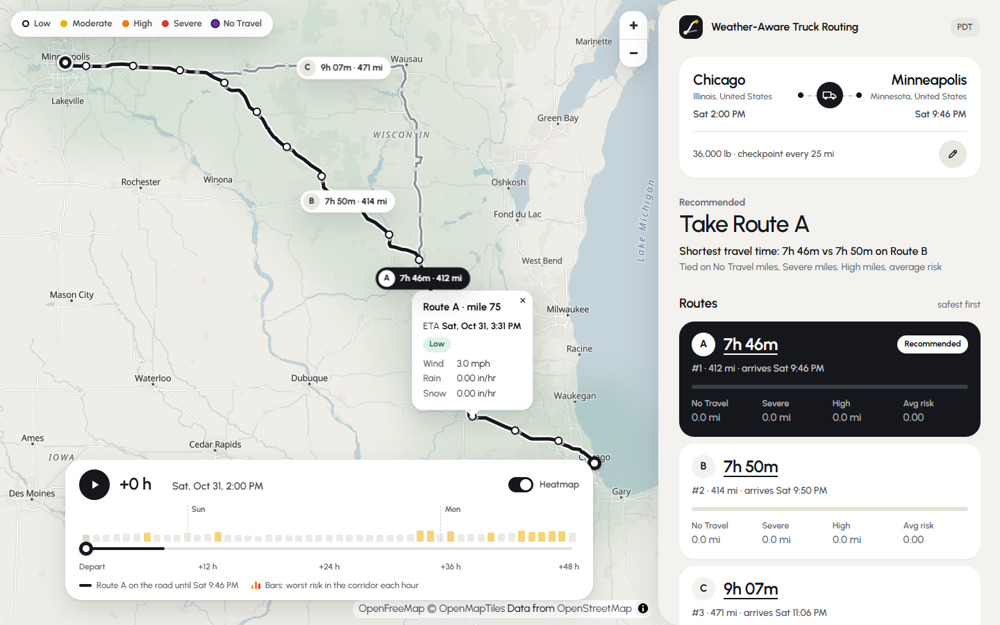

# Weather-Aware Truck Routing

A React + Django app that helps a truck driver pick the safest route. Enter an origin, destination, departure
time and load weight. The app finds **three route options**, samples the forecast **every 10 / 25 / 50 miles at
the truck's estimated arrival time at each checkpoint**, and classifies risk with the assessment's threshold
and load rules. It recommends a route (fewest No Travel → Severe → High miles → lowest average risk →
shortest time) and draws everything on a map, with a **corridor weather heatmap and a 0–48 h forecast slider**.


- **Requirement traceability:** [CHECKLIST.md](CHECKLIST.md) maps every line of the brief to code and tests.



---

## How it works

### 1. Routes: 3 options
[routing.py](backend/trips/services/routing.py) calls OSRM (`alternatives=3`, full geometry plus per-segment
durations). The public server often returns only 1–2 routes, so detour probes run **in parallel with the main
request**. These are routes through points offset perpendicular to the trip. A detour is kept only if it:
- overlaps every kept route on less than 85% of its length,
- is not an out-and-back spur, and
- is at most 1.6× slower than the fastest route.

Corridors with a single real highway (e.g. Seattle → Portland) get one relaxed pass (≤ 2×, ≤ 90%), so three
options are still offered. The ranking decides between them anyway.

### 2. Checkpoints at the truck's ETA
[checkpoints.py](backend/trips/services/checkpoints.py) places checkpoints at mile 0, every *N* miles, and at
the destination. Position and ETA are interpolated along the route. ETAs use OSRM's per-segment durations,
scaled so they sum to the leg time including turn penalties, so slow city miles and fast interstate miles get
correct arrival times. Each checkpoint represents the route miles nearest to it, and those miles add up exactly
to the route length.

### 3. Weather at that time
[weather.py](backend/trips/services/weather.py) uses the Open-Meteo hourly forecast: `wind_speed_10m` in mph,
plus `rain + showers` and `snowfall` in inches.
- **Wind** is interpolated linearly to the ETA.
- **Rain and snow** use the hour the truck is driving through, `[floor(ETA), floor(ETA)+1h)`. Open-Meteo stamps
  hourly precipitation totals at the end of the hour, so that's the value stamped `floor(ETA)+1h`. That hourly
  total is the in/hr rate.
- **Batching:** checkpoints from all three routes are snapped to a 0.05° grid (≈3 mi) and fetched 50 locations
  per request, three requests at a time.

### 4. Risk ([risk.py](backend/trips/services/risk.py)), exactly the brief's tables

| Condition | Low | Moderate | High | Severe | No Travel |
|---|---|---|---|---|---|
| Wind (mph) | < 25 | 25–34 | 35–44 | 45–54 | ≥ 55 |
| Rain (in/hr) | < 0.10 | 0.10–0.25 | 0.25–0.50 | 0.50–1.00 | > 1.00 |
| Snow (in/hr) | < 0.5 | 0.5–1.0 | 1.0–2.0 | 2.0–3.0 | > 3.0 |

Load rules: ≥ 55 mph → No Travel for any load. 45–54 mph with > 30,000 lb → No Travel. 35–44 mph with
> 40,000 lb → Severe. A checkpoint's level is the worst of wind (after load rules), rain and snow. The tests
cover every band edge and every load edge (30,000 vs 30,001 lb, 40,000 vs 40,001 lb).

### 5. Recommendation ([recommend.py](backend/trips/services/recommend.py))
Routes are sorted by (No Travel miles, Severe miles, High miles, mile-weighted average risk 0–4, travel time).
The response explains the decision, e.g. *"Fewest High miles: 0.0 mi vs 30.0 mi on Route A (tied on No Travel
miles, Severe miles)"*.

### 6. Heatmap
[heatmap.py](backend/trips/services/heatmap.py) builds a square grid in Web-Mercator space around the union of
the three routes (±40 mi). For every cell it computes a continuous **risk index** for each of the 49 hours from
departure. The index's integer part always equals the discrete risk level, so heatmap colours match the
checkpoint colours and the legend. The frontend upsamples and smooths each hour once. It then draws the
heatmap with a small **custom WebGL layer** ([heatmapGLLayer.ts](frontend/src/components/map/heatmapGLLayer.ts))
that holds all 49 hours as textures. Moving the slider binds another texture and repaints. There is no
network request, no re-tiling, and no MapLibre style update.

## Decisions where the brief was ambiguous

| Topic | Decision |
|---|---|
| "every 10 / 25 / 50 miles" | The user picks 10, 25 or 50 mi per trip (default 25). *Confirmed.* |
| Slider "0–48 hour" | Hour 0 is the departure hour, so the heatmap lines up with the trip. *Confirmed.* |
| No Travel isn't in the ranking list | It is compared first, because it is strictly worse than Severe. Then rules 1–4 apply exactly. *Confirmed.* |
| "Wind" | Sustained 10 m wind speed, the literal reading. Gusts are not used. *Confirmed.* |
| Shared band edges (0.25, 0.50, …) | Lower bound inclusive: 0.25 in/hr is High. Rain 1.00 and snow 3.0 are still Severe (No Travel is ">"). Wind bands: [25,35), [35,45), [45,55), ≥ 55. |
| "Rain" | Rain + convective showers. Snow is snowfall depth. Both are preceding-hour totals in inches, i.e. in/hr. |
| Miles at a risk level | Each checkpoint represents half the gap to each neighbour. |
| "Average risk" | Low 0 · Moderate 1 · High 2 · Severe 3 · No Travel 4, weighted by miles. |
| Load weight | Pounds, whole numbers, 0–80,000 (the US federal gross weight limit). |
| Departure | Browser local time. Allowed from 1 h ago to 7 days ahead, so trip + 48 h heatmap stay inside the 16-day forecast. |
| Routing profile | OSRM's driving profile. The brief asks for a routing API, not truck restrictions. The public truck router (Valhalla) rejects trips over ~930 mi. |
| Heatmap metric | The continuous risk index (same thresholds and load rules) rather than a raw weather variable. |

## Architecture

```
backend/                       Django 6.1 + DRF 3.18 (Python 3.13)
  config/settings.py           everything from environment variables
  trips/
    models.py                  TripPlan (UUID, inputs, result JSON, heatmap JSON)
    serializers.py             request validation (mirrored in frontend/src/lib/validation.ts)
    views.py                   TripPlanViewSet (create, retrieve, heatmap) · GeocodeView
    exceptions.py              consistent error JSON, 422 no route, 502/503 provider errors
    services/                  pure logic + provider clients (routing, weather, geocoding,
                               checkpoints, risk, recommend, heatmap, planner)
    tests/                     120 tests; providers faked with httpx.MockTransport
frontend/                      React 19 + Vite 8 + TypeScript, TanStack Query, MapLibre GL 6
  src/api/                     typed client + query hooks
  src/components/              TripForm, TripSummary, PlaceInput (combobox), Results, RouteCard, CheckpointList
  src/components/map/          MapView (lazy chunk), layers, HeatmapLayer + heatmapGLLayer, slider
  src/lib/                     risk colours, formatting, validation, heatmap frames
```

A plan is computed once and stored as one row with JSON results. Results are immutable, always read whole, and
never filtered, so normalised tables would add writes without adding value. Storing the plan lets the heatmap
request reuse the route geometry from any worker. There are no list endpoints, so there is nothing to paginate
(DRF's paginator is still configured globally), and no seed data, because all data comes from live forecasts.

### API

| Method & path | Body / query | Responses |
|---|---|---|
| `GET /api/geocode/?q=` | `q` 3–200 chars | 200 `{results: [{label, lat, lng}]}`, 400 |
| `POST /api/trip-plans/` | `origin`, `destination` (text **or** `{label, lat, lng}`), `departure_at` (ISO 8601), `load_weight_lb` (0–80,000), `interval_miles` (10/25/50) | 201 plan · 400 field errors · 422 no drivable route · 502/503 provider error |
| `GET /api/trip-plans/{id}/` | | 200 plan, 404 |
| `GET /api/trip-plans/{id}/heatmap/` | | 200 `{start, hours: 49, grid: {cols, rows, bounds}, cells, values[hour][cell]}`, 404 |

A plan contains `recommendation {route_id, ranking, decided_by, explanation}` and `routes[]`. Each route has
`{id, rank, recommended, distance_mi, duration_s, arrival_at, geometry, summary{miles_by_risk, average_risk,
max_risk, no_travel}, checkpoints[{mile, lat, lng, eta, wind_mph, rain_in_hr, snow_in_hr, risk, conditions,
load_adjusted, miles}]}`. A plan also has `notes[]`, which explain any degradation, for example fewer than three
distinct roads or a coarser weather grid.

## Performance

Measured on this machine against the live public providers.

| What | Result |
|---|---|
| New plan (OKC → Denver, 3 routes, 10-mi checkpoints) | 2.3–6 s, dominated by the public OSRM server |
| Same corridor again with a different load, departure or interval | ~0.4 s (routes and weather are cached) |
| Plan response | ~10 KB gzipped |
| Heatmap | 1.5–3 s cold, 15 ms afterwards (stored on the plan) |
| Slider step (input → painted frame, Intel UHD 620) | 16–18 ms, i.e. one 60 fps frame |
| DB queries | create 1 · retrieve 1 · heatmap 2 the first time, 1 afterwards (asserted with `django_assert_num_queries`) |
| App shell / map chunk | 83 KB / 298 KB gzipped. MapLibre is lazy-loaded while the form renders. |

How the backend stays fast:
- Provider calls run concurrently on a pooled keep-alive `httpx` client.
- Caches: geocoding 24 h, routes 1 h, weather 1 h per grid cell. Weather windows are anchored to the UTC day,
  so changing the departure reuses them.
- Responses are gzipped. Serializers do no per-row work.

How the frontend stays fast:
- TanStack Query keys plans by their inputs, so resubmitting the same trip sends no request.
- Place search is debounced (300 ms) and cached.
- The map is a lazy chunk. Checkpoints are a single GPU circle layer.
- Moving the slider re-renders only the slider component.

## Run locally

Requires Python 3.12+ and Node 20+. The routing, geocoding, weather and map tiles providers need no API keys.

```bash
# backend → http://127.0.0.1:8000/api/
cd backend
python -m venv .venv
.venv/Scripts/activate            # Windows   (macOS/Linux: source .venv/bin/activate)
pip install -r requirements-dev.txt
python manage.py migrate
python manage.py runserver

# frontend → http://localhost:5173 (proxies /api to :8000)
cd frontend
npm ci
npm run dev
```

All settings are environment variables. [.env.example](.env.example) lists them with their defaults, and none
is required for local development.

## Tests

```bash
cd backend  && python -m pytest                    # 120 tests: rules, ETAs, weather timing, routing, heatmap, API + query counts
cd frontend && npm test && npm run typecheck && npm run build   # 32 tests: validation parity, heatmap frames, error mapping, form, result text
```

The backend tests never touch the network: OSRM, Photon and Open-Meteo are replaced by in-process fakes.
[`scripts/smoke_live.py`](backend/scripts/smoke_live.py) runs the pipeline against the real providers.

## Deploy

The repository builds into **one Docker image**: a Node stage builds the SPA, then Django and gunicorn serve
both the API and the app, with WhiteNoise serving pre-compressed, immutable `/assets`.

**Render:** push to GitHub → Render → **New → Blueprint** → select the repo. [render.yaml](render.yaml)
generates the secret key and sets `DJANGO_DEBUG=false` and `DJANGO_ALLOWED_HOSTS=.onrender.com`. Any other
Docker host works too:

```bash
docker build -t truck-routing . && docker run -p 8000:8000 -e DJANGO_SECRET_KEY=change-me -e DJANGO_ALLOWED_HOSTS=localhost truck-routing
```

## Limitations

- **Free weather quota.** Open-Meteo's free API allows 600 calls/min, 5,000/h and 10,000/day per IP, and each
  location counts as one call. A typical plan with its heatmap uses 150–550, and re-planning a corridor is
  mostly cached. If a single plan would exceed its budget (e.g. 10-mile checkpoints from LA to NYC), forecasts
  come from a coarser grid and the response says so. When the quota runs out, the UI shows the provider's
  message and a retry button. Setting `OPEN_METEO_API_KEY` removes all of this.
- **Public OSRM server.** It has no truck restrictions (height, weight, hazmat), latency varies by a few seconds,
  and it asks for light use. `OSRM_BASE_URL` can point to a self-hosted or commercial instance.
- **ETAs are continuous driving time.** They don't include hours-of-service breaks or live traffic. The brief
  doesn't ask for either.
